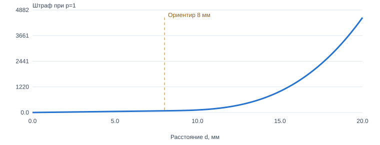
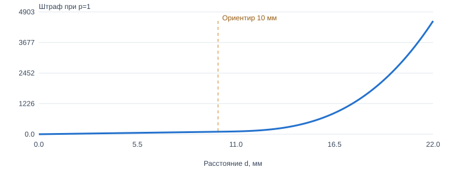
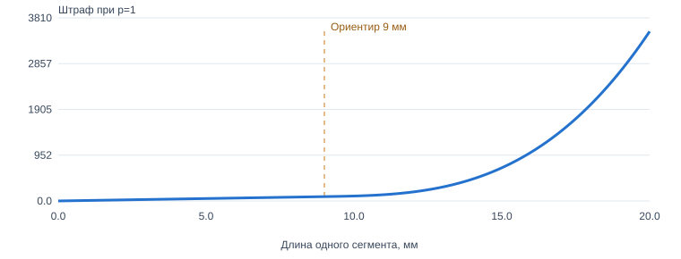
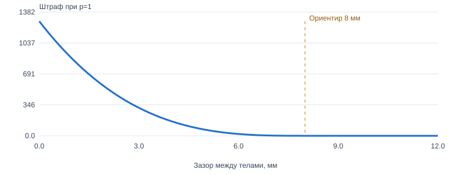
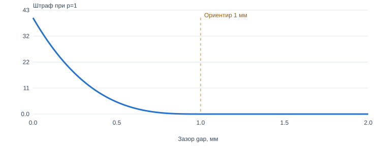
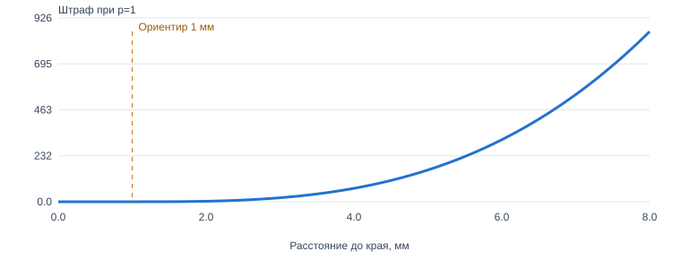
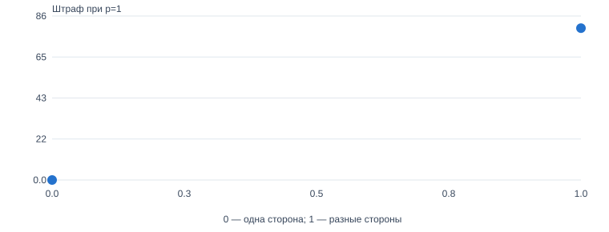
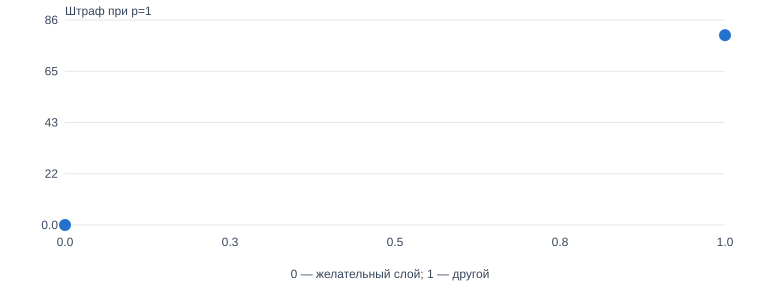
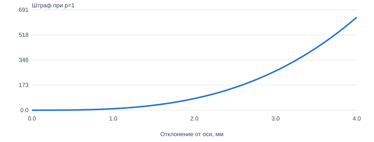
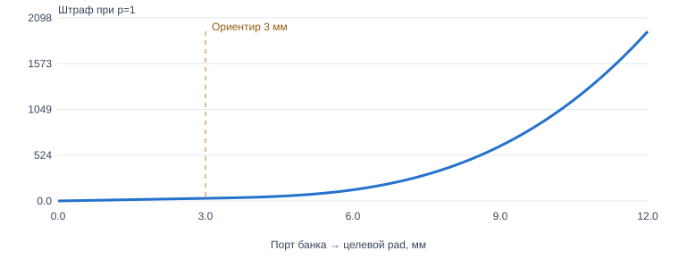

# Предложение кривых relations — v1

Только для согласования. Производственный код и DSL не изменены.

P(d)=10p[d+max(d−M,0)^3/τ²], C(e)=10p·max(e,0)^3/τ². По умолчанию τ=2мм. Приоритеты low=.5 normal=1 high=2 critical=4, применяются один раз. Единица базы:10 баллов за1мм normal-связи. M — мягкий ориентир. Жёсткие ограничения не заменяются баллами.

Кубическая добавка C2-гладкая на M, без потолка. Она не обязана быть лучшей функцией: это предложенная модель с проверяемыми числами. По сравнению с текущим Board масштаб уменьшается резко, это самостоятельное поведенческое изменение, требующее согласования.

## near

```js
near(comp("R21"), comp("U8"), "critical");
```

Мягкое притяжение. Предлагаемый единый M=8 мм; τ=2 мм. Приоритет меняет силу, а не желательную длину. comp — единая согласованная точка компонента, pin — конкретный пад.

P = p·[10d + 2.5·max(d−8,0)³]

Сейчас near normal/low в PostPlace имеет max12, high/critical max8; Board может вообще не иметь max. Унификация до8 — предлагаемое изменение поведения, требует согласования.



## very_near

```js
veryNear(pin("C4", "1"), pin("X1", "1"), "critical");
```

Та же функция, M=3 мм, τ=2 мм. Сила critical выше через один множитель p. Не вводить ещё один скрытый множитель за название very_near.

P = p·[10d + 2.5·max(d−3,0)³]

Сейчас max3/4 зависит от priority; предлагается3 для всех. Действующую трактовку critical как hard не отменять без отдельного решения: график относится к мягкой части.


## cluster_with

```js
cluster(comp("R1"), comp("R2"), "normal");
```

Свободное группирование: M=10 мм, τ=2 мм. Оценивается одна заданная пара, не автоматически все пары кластера.

P = p·[10d + 2.5·max(d−10,0)³]

Сохраняется ориентир10; при объединении блока relation не должен молча менять смысл.



## critical_pair

```js
criticalPair(pin("L1", "2"), pin("U11", "1"), { maxDistance: 9, priority: "critical", hard: false, weight: 1 });
```

M берётся из DSL; график для M=9 мм, τ=2 мм. Если M не задан, предлагаемый документированный default3 мм. Явный weight — единственный дополнительный авторский множитель, без скрытых ×1.8/×2.2/×2.5.

P = p·weight·[10d + 2.5·max(d−M,0)³]

Default3 и отказ от скрытых множителей — проект контракта. minDistance, если задан, добавляет C(max(min−d,0)); hard проверяется отдельно.


## signal_path

```js
signalPath("rf_feed", [[pin("U1", "1"), pin("L1", "1"), { maxDistance: 4 }], [pin("L1", "2"), pin("U11", "1"), { maxDistance: 9 }]], { priority: "critical", hard: false, shape: "straight" });
```

Сегменты используют critical_pair без дополнительного повторного штрафа длины всего пути. Первая кривая ниже — один сегмент M=9. Общий score пути — сумма сегментов плюс отдельные штрафы формы. Для пути без max не придумывать max3: только базовое притяжение.

Ppath = ΣF(segment) + T(форма); ниже показан F одного сегмента

Форма: предложить 10p·[detour + 2·backtrack] + 20p·Σ(1−cos θ) для straight; flexible не штрафовать за сам угол. Facing — отдельно20p·(1−cos θ) на направленный конец. Эти коэффициенты пока гипотеза, не доказанное улучшение. Detour/backtrack частично коррелируют с длиной — отдельно проверить ablation.



## away_from

```js
away(comp("U1"), comp("L1"), "normal");
```

Предпочтительный зазор между телами, не расстояние центров: m=8 мм, τ=2 мм. Когда зазор достаточен, штраф0, дальше раздвигать незачем.

P = p·2.5·max(8−gap,0)³

Сейчас high/critical ориентируются на12мм, остальные8. Единый8 — предложение; конкретные исключения задавать явным clearance. Контроль реального механического минимума остаётся независимо.



## clearance

```js
clearance(comp("U1"), comp("L1"), 1, "normal");
blockClearance("analog", "digital", 1, "normal");
```

m задаётся явно. Для мягкого пожелания τ=0.5 мм; пример m=1 мм. Clearance — тела, blockClearance — заданные оболочки блоков. При hard или обязательном DRC недостаточный зазор недопустим, а не просто дорог.

Psoft = p·40·max(m−gap,0)³; Phard = допустимо / недопустимо

В текущем DSL critical clearance считается hard. Это сохранить при миграции. Сглаживание не разрешает пересечения.



## edge

```js
edge(comp("J1"), "left", "high", "any");
```

Расстояние тела до разрешённой границы. Достаточно попасть в полосу g0=edgeClearance+0.5мм; график для g0=1мм. Внутри полосы0; нарушение физического края проверяется отдельно. Для inward/outward добавить угловой член.

P = p·2.5·max(gap−g0,0)³

Нулевой наклон при входе в допустимую полосу. Отдельные edgeMount/edgePlace описывают механику/геометрию и не должны превращаться в мягкий edge-hint.



## same_side

```js
sameSide(comp("U1"), comp("R1"), "high");
```

Дискретное пожелание:0 при совпадении стороны, 80p при несовпадении. 80 соответствует8мм обычной связи. Это стартовая цена для обсуждения, не цена реального via.

P = 80p·I(стороны различаются)

Непрерывную кривую здесь вводить не нужно. Запрет разрешённых слоёв — отдельное жёсткое правило.



## prefer_layer

```js
Нет отдельной экспортируемой DSL-функции для soft prefer_layer в текущем spec.ts.
Внутренний hint: { relation: "prefer_layer", source: ..., layer: "top", priority: ... }
```

Если внутренний hint используется:0 на желательной стороне,80p на другой. Настройку allowed layers или фиксированный layer не подменять этим мягким пожеланием.

P = 80p·I(слой не совпадает)

Публичный API здесь не придумываем. Если понадобится soft helper, это отдельное изменение DSL.



## line

```js
line(["R1", "R2", "R3"], "x", { gap: 0.5, priority: "high" });
```

Составное намерение: ряд/порядок, ориентация, промежутки. На графике один штраф отклонения центра от целевой оси; τ=1мм. gap задаёт целевую геометрию ряда, не разрешает нарушение DRC.

Palign = p·10·|offset|³; сумма по элементам + отдельные допустимые промежутки

Существующая сборка может генерировать только допустимые ряды: в таком случае не добавлять повторный штраф за уже гарантированное. Не заменять работу генератора одной distance-функцией.



## bypass

```js
bypass(["C15"], pin("X1", "4"), "critical");
```

Питающий pad конденсатора к указанному pad: F с M=3мм и τ=2мм. Ряд/ориентация — отдельная структурная часть. Не притягивать к каждому IC той же сети. График — адресная связь одного конденсатора.

Ptarget = p·F(d;3,2), без отдельной копии того же target penalty

При этом реальное число конденсаторов учитывается явно; не скрывать суммирование. Target задан пользователем, его адресность нельзя заменять центром компонента.


## cap_cluster

```js
capCluster(["C1", "C2"], { powerNet: "VIN", returnNet: "GND", target: pin("U1", "1"), maxRows: 1, priority: "critical" });
```

Составная топология шин/рядов. Целевая связь банка: от лучшего пригодного power-pad банка к указанному pad; M=3мм, τ=2мм. График показывает только эту связь. Остальные конденсаторы держит внутренняя геометрия банка.

Ptarget = p·F(dport;3,2) + отдельные внутренние члены

Выбор ближайшего пригодного power-pad — предложение, требует проверки доступа и связности. Не подключать все конденсаторы к IC отдельными дублирующими critical relations. Return-путь и ориентацию шин сохранять.



## inferred_gnd

```js
Отдельного DSL-вызова нет: addSmallBlockGroundHints() создаёт связи автоматически для маленьких блоков.
```

Сохранить normal: p=1, M=8мм, τ=2мм. Та же near-кривая без critical и без дополнительного ослабления явно созданного hint по имени сети. Eligibility этого hint не менять в этой задаче.

P = 10d + 2.5·max(d−8,0)³

Это не ground spread. Отключение ground spread после4мм — отдельный дефект профиля, не исправляем автоматически в этой работе.


## Дополнительный контракт

corePairs/coreIsland используют кривую critical_pair для каждой пары без скрытого усиления островка. SignalPath без max не получает неявного максимума. Ориентация:20p(1−cosθ) на направленный конец. Равная семантика и вклад relation на всех этапах, без stageMultiplier. Отсутствующий endpoint = unresolved. Постоянные внутренние вклады можно опускать только при сравнении одной rigid-геометрии.

Существующие hard и механические запреты сохранять до отдельного решения. Неявные min0.4/0.8 и max, зависящие от priority, требуют явного решения о миграции. Для line/cap_cluster/bypass график показывает отдельный член составного намерения, не всю многомерную задачу.

Все11 PlacementHint покрыты; prefer_layer не имеет отдельного экспортируемого DSL-helper. DSL-примеры сверены с spec.ts/spec-doc.d.ts. Код оценщиков и DSL не менялся.
